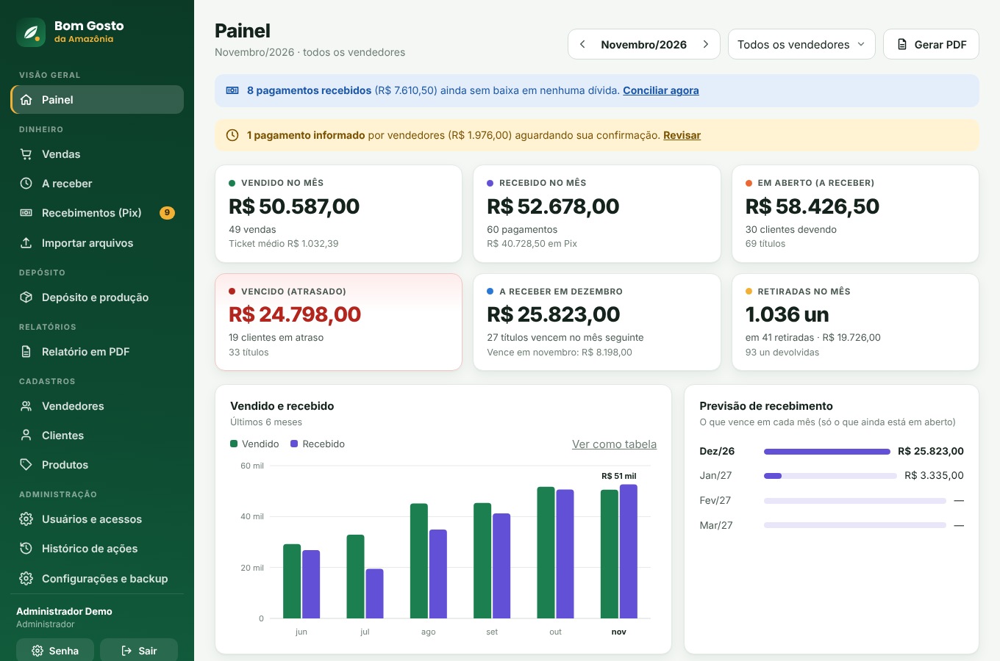

# Painel Bom Gosto da Amazônia

Sistema **web** (abre no navegador do computador ou do celular, sem instalar nada) para controlar **vendas, devedores, Pix, depósito e produção**, com login para os administradores e para cada vendedor.



## O que ele faz

| Área | O que você consegue |
|---|---|
| **Painel** | Vendido no mês, recebido, em aberto, vencido, quanto vence no mês seguinte, retiradas, previsão de recebimento dos próximos meses, resultado por vendedor, maiores devedores. |
| **Vendas** | Lançar venda (à vista ou a prazo com parcelas), cliente novo na hora, itens do catálogo, cancelar, exportar para Excel. |
| **A receber (devedores)** | Todas as dívidas: em aberto, vencidas, a vencer, pagas. **Dar baixa** (total ou parcial), baixa em lote, **cobrar por WhatsApp** com mensagem pronta, ver por cliente. |
| **Recebimentos (Pix)** | Pagamentos que entraram. O painel **sugere em qual dívida cada Pix entra** (compara nome e valor, inclusive 2 ou 3 parcelas juntas) e dá baixa com 1 clique. Vendedor avisa "cliente pagou" e o administrador confirma. |
| **Importar arquivos** | Jogue **PDF, XML de nota fiscal (NF-e), planilha Excel, CSV, extrato OFX e comprovantes de Pix**. O painel lê, separa por vendedor, avisa o que está repetido e mostra uma **prévia** antes de gravar. Qualquer importação pode ser **desfeita**. |
| **Depósito e produção** | Entradas, saídas, perdas, **retiradas dos vendedores** (e devoluções), produção **planejada × produzida** (mostra o que **não foi produzido**), estoque atual, estoque mínimo. |
| **Relatório em PDF** | PDF bonito e direto: 1ª página com **vendido, em aberto, a receber no mês seguinte e retiradas**; páginas opcionais por vendedor e do depósito. Dá para abrir, baixar ou compartilhar no WhatsApp. |
| **Cadastros e acessos** | Vendedores, clientes, produtos, usuários. Administradores veem tudo; **cada vendedor só vê os próprios clientes, vendas e dívidas**. |
| **Segurança** | Histórico de quem fez o quê, backup com um clique, senha protegida, bloqueio de tentativas erradas. |

Mais telas em [`docs/telas`](docs/telas) e um exemplo do PDF em [`docs/exemplo-relatorio-novembro-2026.pdf`](docs/exemplo-relatorio-novembro-2026.pdf).

---

## 1. Testar no seu computador (opcional)

Precisa do [Node.js 22](https://nodejs.org) instalado.

```bash
cd bom-gosto-amazonia
npm install
# cria dados FICTÍCIOS só para conhecer o painel:
DATA_DIR=./data-demo npm run demo
DATA_DIR=./data-demo npm start
```
Windows (PowerShell): `$env:DATA_DIR="./data-demo"; npm run demo; npm start`

Abra <http://localhost:3000> e entre com **admin@demo.com / demo12345** (vendedor de teste: **marcos@demo.com / demo12345**).
Na pasta [`samples/`](samples) há arquivos de exemplo (NF-e, planilha, PDF, Pix, extrato) para testar a importação.

---

## 2. Colocar na internet (Render)

O painel precisa de um servidor que fique ligado e de um **disco permanente** (é onde ficam os dados). A forma mais simples é a [Render](https://render.com). O arquivo [`render.yaml`](../render.yaml) já deixa tudo configurado.

1. Crie uma conta na Render entrando **com o GitHub** e autorize o acesso ao repositório `projetos`.
2. Na Render: **New + → Blueprint** → escolha o repositório → escolha a branch que contém o painel → **Apply**.
3. A Render vai pedir o valor de **`SETUP_CODE`**: invente um código secreto e longo (ex.: `bomgosto-2026-amazonia-x9k2`). Guarde-o: ele só serve para criar o primeiro administrador.
4. Aguarde o primeiro deploy (alguns minutos). A Render mostra o endereço, algo como `https://bom-gosto-painel.onrender.com`.
5. Abra o endereço → tela **Primeiro acesso** → crie a conta do administrador (nome, e-mail, senha e o `SETUP_CODE`).
6. (Opcional) Domínio próprio, por exemplo `painel.bomgostodaamazonia.com.br`: na Render, **Settings → Custom Domains**.

**Custo:** é preciso um plano **pago** (o gratuito não tem disco permanente e os dados seriam perdidos). Na data desta escrita: instância a partir de ~US$ 7/mês + disco ~US$ 0,25 por GB/mês. Confira os valores atuais em <https://render.com/pricing>.

**Atualizações:** quando o código mudar no GitHub, a Render publica sozinha. Os dados ficam no disco e **não se perdem**.

> Se preferir outro serviço (Railway, Fly.io, um servidor VPS), o [`Dockerfile`](Dockerfile) funciona em qualquer um: basta montar um disco em `/data` e definir `SETUP_CODE`.

---

## 3. Primeiros passos no painel

1. **Configurações:** confira o nome da empresa, o **fuso horário** (Manaus, Belém…), o CNPJ e a mensagem de cobrança do WhatsApp.
2. **Usuários e acessos:** crie os outros **administradores** (ex.: Peterson e Seu Messias). Eles entram com e-mail e senha provisória e trocam no primeiro acesso.
3. **Vendedores:** cadastre cada vendedor (marque *Criar acesso* se ele for usar o painel). A **comissão %** aparece como estimativa no painel.
4. **Produtos:** cadastre o catálogo com preço, custo e estoque mínimo.
5. **Alimentar os dados:** lance à mão (*Vendas*, *Lançar dívida*, *Nova movimentação*) **ou** use **Importar arquivos**.

## 4. Importando arquivos

| Arquivo | O que o painel faz |
|---|---|
| **XML de NF-e** (pode enviar vários, ou um `.zip`) | Cria a venda com cliente, itens, valor e **parcelas/vencimentos**. Se a nota tiver "Vendedor: Nome" nas informações adicionais, já atribui ao vendedor. Notas canceladas (XML de evento) cancelam a venda. |
| **Planilha Excel (.xlsx)** | Cada **aba** é lida separadamente e o tipo é identificado (devedores, vendas, depósito, clientes, produtos). Entende "Sim/Não" em *Pago*, datas, valores com vírgula. |
| **CSV** do Excel brasileiro | Separador `;` e acentos (Windows-1252) são reconhecidos automaticamente. |
| **PDF de relatório** (com texto) | Lê como tabela (colunas, linhas, totais ignorados, seções "Vendedor: …"). |
| **Comprovante de Pix (PDF)** | Lê valor, data, **quem pagou**, banco e código da transação; anexa o PDF ao recebimento. Vários comprovantes viram uma única importação. |
| **Extrato bancário OFX** | Só as **entradas** viram recebimentos. |

**Sempre há uma prévia.** Você confere os dados, ajusta (tipo de dado, colunas, vendedor de cada nome, clientes parecidos) e só então confirma. Linhas repetidas vêm desmarcadas. Depois de importar é possível **desfazer**.

O painel **dá baixa automática** quando o Pix tem **nome e valor batendo** com uma dívida do mesmo cliente. Os demais ficam em *Recebimentos → A conciliar* com sugestões.

**Limites conhecidos:** PDF que é foto/escaneado (sem texto) não pode ser lido; planilha antiga `.xls` precisa ser salva como `.xlsx`; cada banco desenha o comprovante de um jeito — se algum não for lido direito, a prévia deixa você preencher o que faltar, e basta enviar um exemplo para a leitura ser ajustada.

## 5. Como os números são calculados

* **Vendido no mês:** soma das vendas ativas com data no mês.
* **Recebido no mês:** soma dos pagamentos confirmados com data no mês.
* **Em aberto:** tudo que ainda falta pagar nas dívidas (hoje, de qualquer mês).
* **Vencido:** parte do "em aberto" cujo vencimento já passou (usa o fuso da empresa).
* **A receber no mês seguinte:** dívidas em aberto que **vencem** no mês seguinte ao escolhido.
* **Retiradas:** unidades retiradas do depósito por vendedores no mês (devoluções aparecem à parte; "em mãos" = retirado − devolvido).
* **Não produzido:** quanto faltou para completar o que foi planejado na produção.
* **Comissão estimada:** % do vendedor sobre o que ele **recebeu** no mês.

## 6. Segurança e cópia de segurança

* **Faça backup toda semana:** *Configurações e backup → Baixar backup agora* (um arquivo com todos os dados). Guarde no Google Drive.
* Cada vendedor só acessa os próprios dados (testado automaticamente). Senhas são guardadas criptografadas; após 8 tentativas erradas o login é bloqueado por 15 minutos.
* Esqueceu a senha? Outro administrador redefine em *Usuários e acessos*. Se for o único administrador: no servidor (Render → **Shell**) rode `node scripts/redefinir-senha.js email@exemplo.com NovaSenha123`.
* Os arquivos enviados (PDF, XML…) ficam no servidor em `/data/uploads`.

## 7. Para quem for mexer no código

* **Tecnologia:** Node.js 22 + Express, banco SQLite (arquivo único em `DATA_DIR/painel.db`), front-end em Preact sem etapa de build, PDF com PDFKit, leitura de PDF com pdf.js.
* **Pastas:** `server/` (API, regras, importação, PDF), `shared/` (dinheiro, datas e nomes — usado no servidor **e** no navegador), `public/` (telas), `scripts/` (demonstração, exemplos, recuperação de senha), `tests/`.
* **Dinheiro** é sempre guardado em **centavos** (inteiro). Datas em `AAAA-MM-DD`.
* **Testes:** `npm test` (33 testes: segurança, isolamento entre vendedores, vendas/baixas, depósito, importação de todos os formatos, PDF).
* **Variáveis:** veja [`.env.example`](.env.example).
